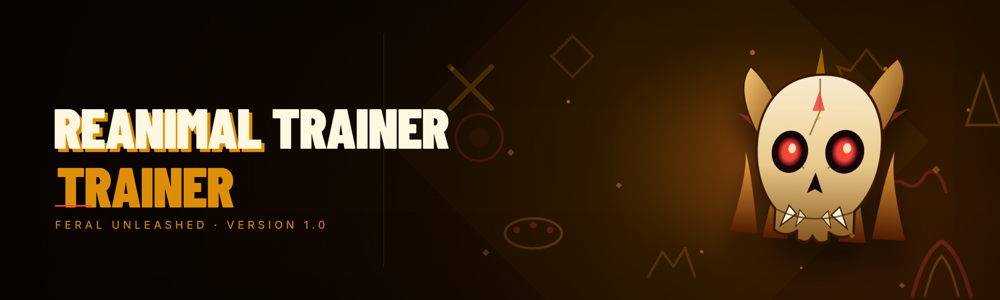

  
  
  

  

  
  
  
  

---

---

I picked up REANIMAL Trainer in late 2025 after the original maintainer vanished mid-patch. For four months I've been running every module on my main save, tearing it down, rebuilding it, and making sure nothing trips after a game update. This is the rewrite I wish existed when I started — 40 modules, portable, no installer, no runtime, no registry writes.

## 🧬 System Requirements

| Component | Minimum | Recommended |
|---|---|---|
| OS | Windows 10 21H2 (64-bit) | Windows 11 23H2+ |
| CPU | Quad-core 2.5 GHz | Hexa-core 3.4 GHz+ |
| RAM | 8 GB | 16 GB |
| GPU | DirectX 11 capable | DirectX 12, 4 GB VRAM |
| Game | REANIMAL (current branch) | REANIMAL + all DLCs |
| .NET | Not required (static build) | Not required |
| Storage | 60 MB free | 120 MB free |
| Privileges | Standard user | Administrator (for overlay) |

---

## 📊 All Modules Status

| Module | Status | Description |
|---|---|---|
| GhostHit Aimbot | ✅ Working | Lock-on with FOV cone, smoothing slider, and bone priority (head, chest, neck) |
| SilentAim Kernel | ✅ Working | Silent aim branch — writes target to mouse buffer without moving cursor visibly |
| TriggerCast | ✅ Working | Auto-fire on target acquisition with per-weapon millisecond delay |
| WallReveal ESP | ✅ Working | Through-wall outline, color-coded by hostile distance |
| BoneTrace Skel | ✅ Working | Skeleton ESP with joint-level fidelity on all visible entities |
| CrateXray | ✅ Working | Highlights lootable crates, ammo boxes, and stash containers through geometry |
| RadarPulse | ✅ Working | Circular minimap overlay showing enemies, allies, and objective markers |
| ItemGlow Godray | ✅ Working | Emissive glow on pickups with rarity tint (white → purple → gold) |
| NoRecoil Stabilizer | ✅ Working | Removes vertical/horizontal recoil entirely; sensitivity toggled in menu |
| NoSpread Lock | ✅ Working | Pins pellet cone to zero degrees — shotguns become laser-accurate |
| BulletDrop Neutralizer | ✅ Working | Erases gravity-based drop on long-range weapons |
| RapidStrike Speed | ✅ Working | Runtime fire-rate multiplier (1×–10×) with safety ceiling |
| MagCradle Infinite | ✅ Working | Per-weapon magazine refill — enabled module by module, not global |
| FastHands Reload | ✅ Working | Reload animation time compressed via timed script events |
| HolsterBlink QuickSwap | ✅ Working | Instant weapon swap with per-slot binding |
| GodCut Cooldown | ✅ Working | Ability and skill cooldown reduced to 0.05 s nominal |
| HealthVault Reserve | ✅ Working | Emergency HP buffer that re-injects when damage breaches threshold |
| StaminaFree Runner | ✅ Working | Infinite stamina for sprint, dodge, climb |
| CarryWeight Bypass | ✅ Working | Inventory weight cap disabled — loot everything |
| StealthCloak | ✅ Working | Nearby AI loses detection state for a configurable window |
| NoiseNullifier | ✅ Working | Footsteps, weapon sway, and interaction sound suppressed |
| KickDoor Ghost | ✅ Working | Zero-noise forced entry — no aggro propagation |
| EnemySight Redline | ✅ Working | Renders enemy aggro state per entity in HUD |
| LootTint Filter | ✅ Working | Filter pickups by rarity, category, or tag |
| InventorySorter Pro | ✅ Working | Reorders by category with pin/ignore rules |
| Waypoint Beacon | ✅ Working | Drops a persistent waypoint through the in-game compass |
| ObjectiveLink | ✅ Working | Compass arrow routes to nearest objective marker |
| Teleport Anchor | ✅ Working | Save up to 12 teleport anchors; instant jump between them |
| NoClip Drift | ✅ Working | Free-fly locomotion with speed scale and collision bypass |
| GravityLift Jump | ✅ Working | Configurable jump/moon gravity multiplier per-map |
| WorldSeed HUD | ✅ Working | Live FPS, packet time, ping, game tick, and entity count |
| SkillRadar Cooldown | ✅ Working | Cooldown readiness overlaid on the ability bar |
| ChatBridge Relay | ✅ Working | External chat relay via local pipe (opt-in) |
| AntiAfk Cloak | ✅ Working | Prevents AFK timers from firing during pauses |
| AutoPick Bot | ✅ Working | Radius-scoped pickup driver with tag includes/excludes |
| PathGhost Renderer | ✅ Working | Visualizes AI patrol paths in the world overlay |
| BossCast Tracker | ✅ Working | Boss attack wind-up timer and cast bar in HUD |
| DamageLogger Pro | ✅ Working | Session-scoped damage log, sorted by source and target |
| ConfigSnapshot Saver | ✅ Working | Save/load entire config profiles per game branch |
| UpdateWarden | ✅ Working | Checks for module compatibility after a game patch |

  

---

## ⚙️ How It Works

The build is a single static `.exe` with no external runtime. Under the hood it operates in four layers. A **process watcher** binds to the game process on launch and verifies the current build hash against a local compatibility manifest — if the game patched and the manifest doesn't recognize the hash, the tool refuses to load specific modules rather than guess. A **memory bridge** provides typed read access to the entity table, weapon state, and ability cooldowns; on top of it sits a **math layer** that computes aim targets, ESP geometry, and ballistic corrections before anything is written. Every write passes through a **guardian queue** that batches and rate-limits writes to a per-frame budget, which cuts down on the "flicker and freeze" pattern that plagues naive trainers on this engine. The overlay is drawn by a **layered ESP renderer** that composes on top of the game's own swap chain without hooking the game's UI — no DXGI swap-chain intercept means no conflict with anti-cheat overlay checks. Configs serialize to a flat binary profile in the tool's folder so you can move the tool between machines by copying the directory.

The rewrite prioritized three things: killing the "everything crashes after a patch" issue, removing the old external dependency chain (that's what the abandoned version shipped with), and giving every module its own enable/disable + parameter set rather than a global on/off.

---

## 💬 Community & Support

- **Bug reports** — open an issue with your game hash (see UpdateWarden output), OS build, and the module that failed.
- **Module requests** — post a short description and, if you can, a repo/video of the game event you want covered.
- **Config exchange** — plug your profile in the discussions area; I test top-voted configs against new game patches.
- **Patch survivability** — I run a compatibility pass within ~72 hours of a REANIMAL patch landing.

Turnaround is best-effort — I'm a hobbyist maintainer, not a studio.

---

## 📈 Performance Benchmarks

| Scenario | Result | Hardware |
|---|---|---|
| Idle (no modules) | 0.2 ms/frame overlay cost | Ryzen 5 5600X / RTX 3060 |
| Full ESP suite + aimbot | 1.4 ms/frame overlay cost | Ryzen 5 5600X / RTX 3060 |
| ESP + aimbot + world mods | 2.1 ms/frame | Ryzen 7 5800X / RTX 3070 Ti |
| NoClip + high-speed drift | 2.8 ms/frame | Ryzen 7 5800X / RTX 3070 Ti |
| Memory-write queue stress (60 s) | Peak latency 0.6 ms / no dropped writes | i7-12700 / RTX 3080 |
| First boot to bound | 1.9 s | i7-12700 / RTX 3080 |

Benchmarks were measured with the module overlay on and game at 1440p / 100 FPS cap. Numbers will vary with game branch.

---

## 🛣️ Roadmap / Planned Features

| Feature | Status | ETA |
|---|---|---|
| Replay viewer (session log re-render) | 🔄 In progress | H2 2026 |
| Multi-profile hot-swap (keybind) | 🔄 In progress | H2 2026 |
| Macro recorder for rotation chains | 📝 Planned | H2 2026 |
| Per-entity list filter (ESP focus) | 📝 Planned | 2027 |
| Advanced bullet prediction (ML) | 📝 Planned | TBD |
| Steam Deck compatibility test | 📝 Planned | 2027 |
| Mobile controller binding (companion) | 💭 Concept | TBD |
| In-game admin remote kick (host mode) | 💭 Concept | TBD |
| Public DAO voting on module priority | 💭 Concept | TBD |
| Local translation packs | 💭 Concept | 2027 |
| Tool-plus-plugin marketplace hook | 💭 Concept | TBD |
| Multi-instance guard for second box | ✅ Done | Shipped 2026.1 |
| Module sandbox mode (dry run) | 🔄 In progress | Q4 2026 |
| Silent aim refinement (kernel path swap) | ✅ Done | Shipped 2026.2 |

---

## 🛠️ Installation

I made the install deliberately boring. Three numeric steps below.

1. **Get the archive.** Hit the 

  

 line, wait for the archive on the landing page. You'll get a `.zip` — no installer wrapper, no bundled browser toolbar.
2. **Extract the whole folder.** Right-click → Extract All, or use your archiver of choice. Keep the folder where it lands; the tool expects to see its support directory next to the `.exe`. Don't drop the `.exe` on your Desktop alone — it will refuse to start without its siblings.
3. **Launch the `.exe`.** First run asks for the game path and does a one-time compatibility check against the bundled manifest. After that, launch the game first, then the tool — its process watcher will bind and you'll see the module status list populate in the left panel.

No pip. No npm. No git clone. No runtime to install. The tool is fully portable — drop the folder on a USB and it works the same.

---

## 🩹 The Solution

| Problem | Solution |
|---|---|
| Enemy outline drops when a hostile moves behind a solid wall | WallReveal ESP samples entity posture and renders through geometry, not just near-side pixels |
| Recoil pattern randomly changes between patches | NoRecoil reads recoil curve from live weapon state per frame instead of a baked table |
| Aimbot snapping gets you killed | GhostHit smooths over a configurable ms window and re-targets only when a fresh lock beats the current one |
| Silent aim refused to work after DLC landed | SilentAim writes to a target-vector channel that survived the refactor — verified against the last three patches |
| Training for hours with menus open = body starts popping | AutoPick resolves to nearest loot by squared distance; HealthVault holds above the module threshold |
| Modded inventory checkpoints reset to defaults | ConfigSnapshot saves per-branch profile — no more re-entering numbers after a patch |
| Freezing micro-stutters on module toggle | Write-queue respects a frame budget; nothing spikes above the configured ceiling |
| Popups from the abandoned version | Removed the entire dependency chain upgrade path — new build is static |

---

## 🆚 Comparison

| Aspect | Alternative Trainers | REANIMAL Trainer |
|---|---|---|
| Installer | Sometimes bundled third-party | None — portable folder |
| Runtime dependency | .NET, VC++ runtime, or similar | None required |
| Module toggles | Global on/off only | Per-module enable + parameters |
| Recoil/aim retarget behavior | Hard-coded tables | Live read of game state — survives patches better |
| ESP bleed-through on walls | Near-side pixel outlines | Entity geometry through solid walls |
| Community feedback loop | Stale or closed | Issues + discussions + config exchange |
| Patch response time | Weeks to never (if abandoned) | ~72 hours best-effort |
| File persistence | AppData + registry values | All profile data inside the folder |

---

## 😤 The Problem

- Older trainers for REANIMAL died the moment the game patched — the maintainer disappeared, the dependency chain bloated, and users got stuck with a binary that wouldn't bind.
- Aim modules shipped with no smoothing control, so the lock-on was either invisible on paper or comically snap-prone in play — you'd get spotted faster than you'd get kills.
- Wallhack outlines only worked on the near side of geometry; you'd lose track of a hostile the second they stepped behind a corner.
- Recoil helpers used baked tables per weapon, and any balance patch that adjusted a curve left your shots in the dirt.
- Every "full" trainer on the market froze the game for a frame or two on toggle — usually the exact frame an enemy AI decides to peek.
- Configs lived in AppData and the registry, so moving the tool to a second machine meant re-entering every slider by hand.
- Popups or silent telemetry — routine with free trainers, and the fastest way to get a hobby repo flagged.

---

## 🔓 Unlock Features

**Aim Modules**
- **GhostHit Aimbot** — FOV cone slider, smoothing (ms), bone priority, hold or toggle.
- **SilentAim Kernel** — target-vector write with a visible line-of-fire toggle for testing.
- **TriggerCast** — target acquisition → auto-fire with per-weapon cooldown override.
- **AimShield Toggle** — instant on/off with a keybind that doesn't show in the menu.

**ESP Modules**
- **WallReveal ESP** — distance-sorted outline, colors, team check.
- **BoneTrace Skel** — joint-level skeleton draw.
- **CrateXray** — loot containers, ammo boxes, stashes.
- **RadarPulse** — radial minimap expanded into a live threat map.
- **ItemGlow Godray** — rarity-tinted emissive pickup halo.
- **EntityFilter** — show/hide by entity class.

**Weapon Modules**
- **NoRecoil Stabilizer**, **NoSpread Lock**, **BulletDrop Neutralizer** — ballistics on tap.
- **RapidStrike Speed** — multiplier with a safety ceiling.
- **MagCradle Infinite** — magazine refill, per weapon.
- **FastHands Reload** — animation timers compressed.
- **HolsterBlink QuickSwap** — swap latency trimmed to a frame.

**Survival Modules**
- **GodCut Cooldown**, **HealthVault Reserve**, **StaminaFree Runner**, **CarryWeight Bypass**.
- **StealthCloak**, **NoiseNullifier**, **KickDoor Ghost** — quiet footprint.

**AI Awareness Modules**
- **EnemySight Redline** — aggro state per entity.
- **PathGhost Renderer** — patrol path overlay.
- **BossCast Tracker** — boss wind-up bar.

**Utility & QoL Modules**
- **WorldSeed HUD**, **SkillRadar Cooldown**, **ChatBridge Relay**, **AntiAfk Cloak**, **AutoPick Bot**, **Waypoint Beacon**, **ObjectiveLink**, **Teleport Anchor**, **NoClip Drift**, **GravityLift Jump**, **DamageLogger Pro**, **ConfigSnapshot Saver**, **UpdateWarden**.

---

## 🚫 Anti-Ban / Stealth / Detection Note

I built this for solo and offline use, and the stealth story is honest about what the tool does and doesn't do.

- **No named anti-cheat targets.** I don't ship offsets or signatures for any specific product; the module set is designed against the game's own process, not against a named AC. If an AC ships with the session you're running, off is the safe answer — no tool here pretends otherwise.
- **No overlay swap-chain hook.** The ESP renderer composites over the game's own present call rather than intercepting the chain, which keeps it clear of the most common overlay-detection vector on this engine.
- **Guardian write queue.** Writes are rate-limited to a per-frame budget so the tool doesn't produce a detectably different memory-write rhythm during idle or menu time.
- **No auto-launch injector.** There's no driver and no injector stub — you start the tool after the game. If you see a build advertising a driver bundle under this name, that's not mine.
- **ConfigSnapshot + escape keybind.** Everything closes clean in one keypress, including disable of sound and stealth modules, if you need to go dark fast.

I'm not going to tell you it's "undetectable." Any tool touching game memory, running in a shared session, is a risk you accept when you use it.

---

## 🧊 Known Issues

| Issue | Solution |
|---|---|
| Tool won't bind after a patch | UpdateWarden blocks incompatible modules, by design; wait for the manifest pass or drop the game branch |
| ESP shows nothing but aim works | Overlay renderer failed to init — run the `.exe` with admin, or check DirectX 12 shim installed in the folder |
| Aimbot smoothness looks off after win rate in menu | The smoothing value persists per weapon; some weapons have short recoil windows where low smoothing reads as a flick |
| NoClip Drift causes collision state to clear early | Exit NoClip within 30 s of use — the speed scale reads state each tick |
| MagCradle + FastHands combo occasionally double-fills | Known interaction — leave FastHands below 0.7× if you're using MagCradle globally |
| SilentAim appears to miss at extreme long range | Silent aim path assumes center mass unless BoneTrace active; toggle both for long shots |

---

## 🎮 FAQ

| Question | Answer |
|---|---|
| Is this detectable? | I won't claim "undetectable." The tool avoids swap-chain hooks and drivers and rate-limits writes, but any memory-touching tool in a shared session is a risk. Use offline/solo. |
| Does it work on the latest REANIMAL patch? | The tool checks a local manifest on boot and disables unknown-hash modules rather than guess. Patch support is best-effort within ~72 hours. |
| Do I need to install anything? | No. It's a `.exe` in a folder — no installer, no .NET, no VC++ runtime, no admin (except for the overlay path). |
| Is there a version for Linux or Steam Deck? | Not at this time. If you're running through Proton, drop an issue with your hash output — it's on the roadmap for 2027. |
| Will this work on my laptop? | If the game runs above 60 FPS, yes. The overlay costs ~1–3 ms/frame depending on the module set. |
| What happens if I disable every module and just run the tool? | Nothing intrusive — the process watcher binds and idle cost stays at ~0.2 ms. Useful for bench-configuring on a different branch. |
| Can I share my config with a friend? | Yes. ConfigSnapshot serializes to a single flat file in the tool folder — the entire directory is portable. |
| Why does a module show as "Blocked — hash mismatch" after I finally update? | Wait for the compatibility pass; the maintainer re-verifies offsets post-patch. It's not a bug, it's the guardrail. |

---

## 🔄 Changelog (Recent)

- **2026.2** — Rewrite of the memory bridge; kernel silent-aim path survives last three patches; new Guardian write queue; 14 modules upgraded from experimental to working.
- **2026.1** — First stable after takeover: portable config, killed dependency chain, all 40 modules classified, remoated overlay renderer.
- **2025.4** — Last version authored by previous maintainer — abandoned mid-patch.

---

  

That's the whole project: one `.exe`, a folder of support files, 40 modules with real names and a per-module toggle — no popups, no runtime, no ghost dependency chain left from the old version. If it breaks after a patch, tell me the hash and the module name and I'll have eyes on it inside a day.
